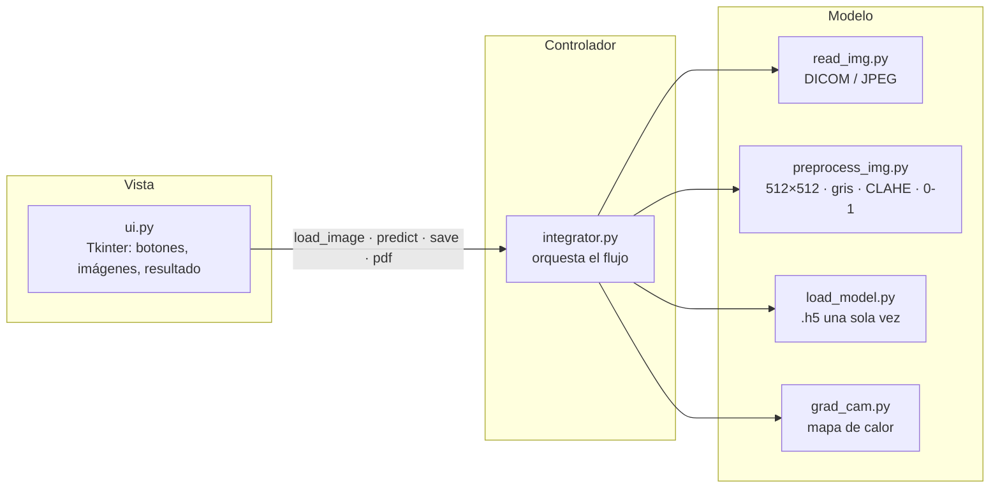

# Detector de neumonía — del monolito al sistema

Refactor del proyecto [`dalquinones/UAO-Neumonia`](https://github.com/dalquinones/UAO-Neumonia):
el archivo único `detector_neumonia.py` (251 líneas) se separa en **seis módulos con
responsabilidad única** siguiendo MVC, **sin cambiar el comportamiento**: la aplicación
carga una radiografía (DICOM o JPEG), la clasifica en *bacteriana*, *normal* o *viral*
y muestra el mapa de calor Grad-CAM.

> Universidad Autónoma de Occidente · Desarrollo de Proyectos de IA · 2026-6B · Módulo 1

| Rol | Integrante | Módulos a cargo |
|---|---|---|
| Capitán | Jorge Enrique Gutiérrez Ramírez | `load_model.py`, `grad_cam.py` |
| Revisor de código | Javier Henao Hernández | `integrator.py`, `ui.py` |
| Integrante | Daniela Olave Alarcón | `read_img.py`, `preprocess_img.py` |

> ⚠️ Herramienta académica de apoyo. No reemplaza el diagnóstico de un profesional de la salud.

---

## Inicio rápido

Requisitos: [`uv`](https://docs.astral.sh/uv/), Git y `make`. Python 3.13 lo instala `uv`
automáticamente a partir de `.python-version`. Funciona igual en **macOS, Windows y Linux**
(la CI lo verifica en los tres sistemas).

<details open>
<summary><b>macOS / Linux</b> (Terminal)</summary>

```bash
git clone <URL-del-repo-del-equipo>.git
cd uao-neumonia
make install                      # uv sync --frozen → .venv idéntico a uv.lock
cp /ruta/a/conv_MLP_84.h5 models/ # el modelo NO se versiona (118 MB > límite de GitHub)
make run                          # abre la interfaz
make check                        # ruff + formato + pytest
```

Modelo en otra ruta: `NEUMONIA_MODEL_PATH=/ruta/modelo.h5 make run`

Instalar herramientas: `brew install uv git make` (o `curl -LsSf https://astral.sh/uv/install.sh | sh`).
</details>

<details open>
<summary><b>Windows</b> (PowerShell)</summary>

```powershell
git clone <URL-del-repo-del-equipo>.git
cd uao-neumonia
make install
Copy-Item "C:\ruta\a\conv_MLP_84.h5" models\   # el modelo NO se versiona
make run
make check
```

Modelo en otra ruta: `$env:NEUMONIA_MODEL_PATH = "C:\ruta\modelo.h5"; make run`

Instalar herramientas: `winget install astral-sh.uv Git.Git ezwinports.make`
(o `choco install make`). Cierre y vuelva a abrir PowerShell después de instalar.
Sin `make`, cada atajo equivale a un comando `uv` (ver la tabla de abajo).
</details>

| Comando | Qué hace | Equivalente sin `make` |
|---|---|---|
| `make install` | Crea el entorno con las versiones exactas de `uv.lock` | `uv sync --frozen` |
| `make run` | Abre la interfaz | `uv run python -m src.ui` |
| `make test` | Corre las pruebas con pytest | `uv run pytest` |
| `make lint` / `make format` | Ruff (lint / formato) | `uv run ruff check .` / `uv run ruff format .` |
| `make check` | Lint + verificación de formato + pruebas | los tres comandos anteriores |
| `make clean` | Borra cachés, `historial.csv` y `Reporte*.pdf` | — |
| `make help` | Lista los comandos | — |

El `Makefile` solo invoca `uv` (no usa `rm`, `cp`, `grep` ni `awk`), por eso corre igual en
cmd, PowerShell, Git Bash, macOS y Linux. El archivo `.gitattributes` fija finales de línea LF
para que Git en Windows no convierta el `Makefile` a CRLF.

Imágenes de prueba: descomprimir `DICOM.zip` y `JPG.zip` en `data/` (ignorado por Git).

## Uso de la interfaz

1. Escribir la cédula del paciente.
2. **Cargar Imagen** → seleccionar un `.dcm`, `.jpg`, `.jpeg` o `.png`.
3. **Predecir** → resultado, probabilidad y Grad-CAM.
4. **Guardar** agrega una fila a `historial.csv`; **PDF** genera `ReporteN.pdf`; **Borrar** limpia todo.

---

## Arquitectura



**Regla de dependencia:** `ui.py` solo importa `integrator`. Nunca TensorFlow, Keras ni
`load_model`. La prueba `tests/test_architecture.py` lo verifica analizando el AST de `ui.py`,
así que si alguien rompe la regla, `make check` queda en rojo.

| Archivo | Responsabilidad única | Entra → Sale |
|---|---|---|
| `src/load_model.py` | Cargar `conv_MLP_84.h5` una vez (`lru_cache`) | ruta → modelo Keras |
| `src/read_img.py` | Leer DICOM y JPEG/PNG, escalar a 0-255 | archivo → (arreglo, imagen PIL) |
| `src/preprocess_img.py` | Resize 512×512, gris, CLAHE, normalizar, batch | arreglo → tensor `(1,512,512,1)` |
| `src/grad_cam.py` | Generar y superponer el mapa de calor | modelo + tensor → imagen RGB 512×512 |
| `src/integrator.py` | Orquestar leer → preprocesar → predecir → explicar; historial y PDF | ruta/arreglo → `Prediction` |
| `src/ui.py` | Mostrar y capturar eventos | clics → llamadas a `integrator` |

Principios aplicados: **SRP** (un motivo de cambio por módulo), **inversión de dependencias
en Grad-CAM** (recibe el modelo en vez de cargarlo, lo que permite probarlo con un modelo
diminuto) y **fachada** (`integrator` es la única API que conoce la vista).

## Decisiones y cambios respecto al monolito

El comportamiento observable se conserva (mismas clases, mismo preprocesamiento, misma capa
`conv10_thisone`, mismo formato de `historial.csv`). Los cambios fueron necesarios para que el
código corra en Python 3.13 o corrigen errores que impedían ejecutarlo:

| Monolito | Problema | Ahora |
|---|---|---|
| `tf`, `K` y `dicom` usados sin importar | `NameError` al ejecutar | Imports explícitos por módulo |
| `K.gradients` + `disable_eager_execution` (TF 1) | No existe en TF 2.21 / Keras 3 | `tf.GradientTape` (mismo cálculo) |
| Bucle `range(64)` sobre una capa de **128** filtros | Solo ponderaba la mitad de los filtros | Pondera todos los filtros (Grad-CAM estándar) |
| `dicom.read_file` | Eliminado en pydicom 3 | `pydicom.dcmread` |
| `Image.ANTIALIAS` | Eliminado en Pillow 10 | `Image.LANCZOS` |
| Botón *Cargar* siempre usaba `read_dicom_file` | Fallaba con JPEG | `read_image` despacha por extensión |
| `model.predict` llamado 3 veces y modelo cargado en cada clic | Lento | Modelo cacheado y una sola predicción |
| `heatmap /= max` | División por cero si el mapa es 0 | Se normaliza solo si `max > 0` |
| PDF con `tkcap` + `pyautogui` (captura de pantalla) | Depende del sistema de ventanas | PDF compuesto con Pillow (mismo contenido) |
| `requirements.txt` + `pip` + Dockerfile con `python:latest` | Prohibido en el curso / no reproducible | `pyproject.toml` + `uv.lock`; Docker se retoma en M4 |
| `cv2.imread(ruta)` | En Windows no abre rutas con tildes o ñ (p. ej. `GESTIÓN`) | `np.fromfile` + `cv2.imdecode` (funciona en todo SO) |

Dependencias: `opencv-python-headless` en lugar de `opencv-python` porque la interfaz es
Tkinter y no se usa la GUI de OpenCV (evita conflictos de Qt). `matplotlib`, `pandas`,
`img2pdf`, `tkcap`, `pyautogui` y `python-xlib` se eliminaron por no usarse.

## Pruebas

28 pruebas con patrón **AAA** (Arrange / Act / Assert):

| Archivo | Qué cubre |
|---|---|
| `test_read_img.py` | DICOM → RGB uint8, escala a 255, JPEG, rutas con tildes, despacho por extensión, formato no soportado |
| `test_preprocess_img.py` | Forma del tensor, rango [0, 1], entrada en gris |
| `test_load_model.py` | Error claro si falta el `.h5`; el modelo se carga una sola vez |
| `test_grad_cam.py` | Heatmap normalizado, salida 512×512×3, heatmap en cero sin NaN |
| `test_integrator.py` | Mapeo de etiquetas, clase inválida, orquestación con doble de prueba, CSV, PDF |
| `test_ui.py` | Cargar imagen habilita *Predecir*, cancelar no, resultado en pantalla, *Guardar* sin predicción, *Borrar* (integrador simulado, sin modelo) |
| `test_architecture.py` | La UI no importa TF/Keras/`load_model`, solo `integrator`; existen los seis módulos |
| `test_end_to_end.py` | Predicción con el modelo real (se omite si el `.h5` no está, p. ej. en CI) |

Las imágenes DICOM y JPEG de las pruebas se generan en `tmp_path`, así que no hace falta
subir datos de pacientes al repositorio. Validación manual con los insumos del curso: los 4
DICOM se clasifican correctamente y, en una muestra de 60 JPG (20 por clase), 55 coinciden
con la carpeta de origen.

## Flujo de trabajo (Gitflow)

- `main`: versión entregada. `develop`: integración.
- Ramas `feature/<módulo>` desde `develop`; todo entra por **Pull Request** con la plantilla
  `.github/pull_request_template.md` y la aprobación de otro integrante.
- Commits convencionales: `feat:`, `fix:`, `test:`, `docs:`, `refactor:`, `chore:`, `ci:`.
- GitHub Actions ejecuta `make check` en cada PR, en **Ubuntu, macOS y Windows**
  (en Linux con `xvfb-run` para que las pruebas de Tkinter tengan pantalla).

```bash
git checkout develop && git pull
git checkout -b feature/<tema>
# ... cambios ...
make check
git commit -m "feat(read_img): descripción corta"
git push -u origin feature/<tema>   # luego abrir el PR hacia develop en GitHub
```

## Créditos

Proyecto original: Isabella Torres Revelo y Nicolás Díaz Salazar. Modelo basado en F. Pasa et al.,
*Efficient Deep Network Architectures for Fast Chest X-Ray Tuberculosis Screening and Visualization*.
